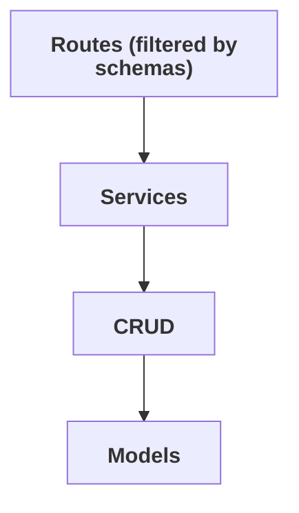

# MonManager

A Pokemon-like monster server built for ComputerCraft, powered by FastAPI, PostgreSQL — fully Dockerized.

---

## Stack

| Service | Image | Purpose |
|---|---|---|
| `api` | Custom (FastAPI) | REST + WebSocket game server |
| `db` | postgres:16-alpine | Persistent player/monster data |

---

## Requirements

Docker

---

## Quick Start

```bash
# 1. Build and start
make build
make up
make seed

# 2. Check API docs
open http://localhost:8000/docs

# 3. [Optional] Start the craftos CC emulator container and utilize the test_harness
make client-build
make client
> test_harness
```

---

## Project Structure

```
├── api
│   ├── crud
│   │   └── ...                     # Database manipulations (Create Read Update Delete)
│   ├── database.py
│   ├── dependencies.py
│   ├── Dockerfile
│   ├── docs
│   │   └── ...                     # Architecture documentation markdown files
│   ├── main.py
│   ├── models
│   │   └── ...                     # Database table structure and relationships
│   ├── pyproject.toml
│   ├── requirements.txt
│   ├── routes
│   │   └── ...                     # FastAPI endpoint routes
│   ├── schemas
│   │   └── ...                     # FastAPI schemas for endpoint input/output structuring
│   └── services
│       └── ...                     # Backend logic
└── client
    └── ...                         # Computercraft client harness for testing
```

**Structured Flow:**


---

## Key Endpoints

player.py
- [X] `POST     /player                         -- create player`
- [X] `GET      /player                         -- [AUTH] list all players`
- [X] `GET      /player/{id}                    -- [AUTH] get specific player by id`

monster.py
- [X] `GET      /monster/                       -- [AUTH] list a player's monsters`
- [X] `GET      /monster/{id}                   -- [AUTH] get specific monster by id`

encounter.py
- [X] `POST     /encounter/wild                 -- [AUTH] attempt a wild monster`
- [X] `POST     /encounter/surrender            -- [AUTH] forfeit the battle`
- [X] `GET      /encounter/                     -- [AUTH] get the details of current encounter`
- [ ] `GET      /encounter/{id}                 -- [AUTH] get the status of a battle (possibly spectating)`
- [X] `POST     /encounter/challenge            -- [AUTH] create challenge against a player`
- [X] `POST     /encounter/challenge/respond    -- [AUTH] respond to received challenge`
- [X] `POST     /encounter/challenge/cancel     -- [AUTH] attempt to cancel sent challenge`
- [X] `GET      /encounter/challenges           -- [AUTH] get current player's current sent and received challenges`

battle.py
- [ ] `POST     /battle/attack                  -- [AUTH] attempt an attack`
- [ ] `POST     /battle/swap                    -- [AUTH] attempt to swap monsters`
- [ ] `POST     /battle/catch                   -- [AUTH] attempt to catch wild monster`
- [X] `GET      /battle/moves                   -- [AUTH] get your active monsters moves`
- [ ] `GET      /battle/                        -- [AUTH] get the status of current battle`


Full docs at: `http://localhost:8000/docs`

---

## ComputerCraft

### Emulation

Emulation can be done utilizing craftos

https://www.craftos-pc.cc/docs/installation

For cli testing utilize `make client-build` and `make client` to execute a containerized craftos emulation.

Execution of the client code can be done by executing `test_harness` when in the emulator.

```bash
> test_harness

=== Menu ===
1. Current Player Info
2. Player Info
3. Players
4. Wild Encounter
5. Surrender Encounter
6. Encounter Info
7. Catch Attempt
8. Attack Attempt
9. Moves
10. Player Monsters
11. Monster Info
0. Exit
Select: 
```


### Usage

```lua
-- List all players
local res = http.get("http://YOUR_IP:8000/player")
local players = textutils.unserialiseJSON(res.readAll())
res.close()
```
Most endpoints require an API key that is given upon account creation.

**Note:**
In order to allow external connections **the server computercraft config must allow connections to the endpoints**.

This includes setting the appropriate http rule for the docker container host machine (ex: 192.168.1.123)
as well as enabling http and websockets. 
```bash
    # config/computercraft-server.toml
    ...
        [http]
        enabled = true
        websocket_enabled = true
    ...
        [[http.rules]]
                host = "192.168.1.123"
                port = 8000
                action = "allow"
    ...
```
Firewall rules may apply, check connect-ability with the following

```bash
    # Check if the server machine can connect
    curl http://192.168.1.123:8000/docs
```

```lua
    -- Check inside computercraft terminal if settings were configured correctly
    http.get("http://192.168.1.123:8000/docs")
```

---

## Makefile commands

```bash
build-clean:     Build the containers fresh
build:           Build the containers
db-command:      Enter postgres container for SQL commands
down:            Shut the docker containers down
lint:            Linting fixes to the api directory
lint-check:      Check for linting issues without fixes
help:            Show this help message
logs:            View the logs from the docker containers
nuke:            Nuke the database and re-seed it
refresh-clean:   Build the containers fresh then restart them
refresh:         Build the containers then restart them
seed:            Seed the data into the database
up:              Bring the docker containers up
client-build:    Build the craftos client image
client:          Start a client (CLIENT=2, POCKET=1, or WIDTH=n HEIGHT=n)
pocket:          Shortcut for a pocket-sized client
kill-clients:    Kills all craftos client containers
```
